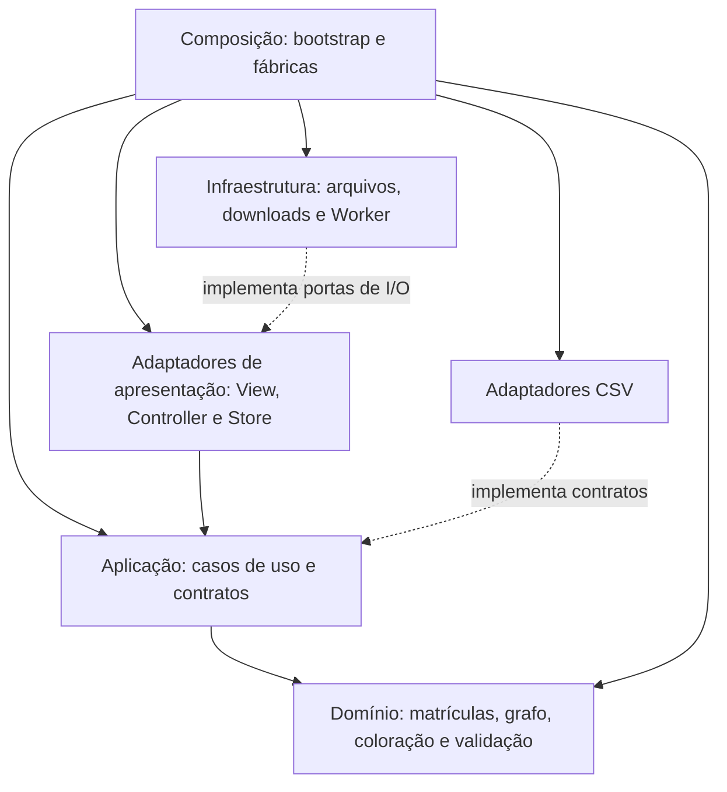

# Arquitetura do Croma

A leitura do arquivo, a estratégia de coloração e a interface podem evoluir separadamente. O domínio e os casos de uso rodam em Node.js ou no navegador com as mesmas regras.

## Regra de dependências

As dependências do código apontam para as regras de negócio. Os pontos de composição conhecem as implementações concretas e conectam as camadas.



O diagrama representa dependências e contratos. As chamadas em tempo de execução podem atravessar uma porta para uma implementação externa, sem exigir que a camada interna importe essa implementação.

## Estrutura

```text
src/
  domain/
    enrollment-dataset.js       Matrículas, duplicatas e validações
    conflict-graph.js           Relações entre disciplinas
    dsatur-coloring.js          Strategy padrão
    schedule.js                 Validação e criação dos blocos
  application/
    ports.js                    Contratos de leitura, coloração e escrita
    import-enrollments.js        ImportEnrollments
    generate-schedule.js        GenerateSchedule
    export-schedule.js          ExportSchedule
  adapters/
    csv/                       Leitor CSV, mapeamento e exportação
    presentation/
      planner-controller.js    Coordenação dos comandos
      planner-store.js         Estado observável
      planner-view.js          Eventos e composição visual
      ports.js                 Contratos de I/O da apresentação
      views/                   Grade, grafo e matrículas
      formatters.js            Cores, textos e rótulos de horas
      help-dialog.js           Conteúdo e interação da ajuda
  infrastructure/
    browser/
      browser-files.js         Leitura de File e download com Blob
      schedule-executor.js     Execução local ou em Worker
  composition/
    create-services.js         Montagem dos três casos de uso
    create-generator.js        Montagem do gerador com sua Strategy
  data/
    example.js                 Matrículas e catálogo da demonstração
  bootstrap.js                 Ponto de entrada da página
  worker-bootstrap.js          Ponto de entrada do Worker
public/                        HTML, CSS, ícone e CSV de exemplo
scripts/build.cjs              Geração de dist/
tests/                         Testes de comportamento e arquitetura
```

## Responsabilidades

### Domínio

`EnrollmentDataset.fromRecords()` recebe registros neutros com `student`, `code` e `name`. Valida identificadores, nomes, cardinalidades e duplicatas. Identificadores são texto para preservar valores como `0001`.

`createConflictGraph()` cria uma aresta para cada par de disciplinas cursadas pelo mesmo aluno. `DsaturColoring.color()` devolve o mapa de cores.

`createValidatedSchedule()` exige uma cor inteira e não negativa para cada vértice e verifica todas as arestas. Uma Strategy incompleta ou conflitante é rejeitada. Rótulos de cor esparsos são convertidos em blocos contíguos.

Nenhum arquivo do domínio acessa DOM, CSV, rede, armazenamento ou Workers. O catálogo da demonstração é fornecido como dado pela composição.

### Aplicação

- **ImportEnrollments:** recebe um leitor pelo contrato `EnrollmentReader`, cria o conjunto de matrículas e acrescenta contexto de origem aos erros de validação.
- **GenerateSchedule:** constrói o grafo, chama `ColoringStrategy.color()` e valida o resultado no domínio.
- **ExportSchedule:** prepara linhas neutras com horário, sigla, nome e quantidade de alunos e as entrega a `ScheduleWriter.write()`.

Os contratos são documentados com JSDoc e verificados por testes de comportamento. As classes recebem objetos compatíveis no construtor; não há exigência de herança.

### Adaptadores

`CsvReader` trata separadores, aspas, BOM e quebras de linha. `EnrollmentCsvReader` interpreta o cabeçalho e converte células em registros neutros, incluindo rótulos como “Linha 2”. `ScheduleCsvWriter` define cabeçalho, codificação, escapes e proteção contra fórmulas de planilha.

`PlannerController` coordena importação, geração e download. Usa casos de uso e portas injetadas; não acessa o DOM nem cria Workers. Também impede que uma leitura antiga substitua uma importação mais recente e mantém o último resultado válido em caso de erro.

`PlannerStore` publica snapshots para os assinantes. O snapshot superior é congelado; os mapas e conjuntos internos são modelos compartilhados para leitura, sem promessa de imutabilidade profunda. `PlannerView` observa o estado, traduz eventos em comandos e delega a renderização para componentes menores. Filtros, paginação e rótulos de horas pertencem à apresentação.

### Infraestrutura e composição

`BrowserFileReader` usa a API `File`; `BrowserDownloader` usa `Blob` e URLs temporárias. `BrowserScheduleExecutor` usa um Worker quando disponível e recorre ao mesmo caso de uso local quando a criação ou o carregamento do Worker falha.

O Worker recebe matrículas normalizadas por clonagem estruturada, calcula a grade e devolve mapas e conjuntos. A leitura do CSV permanece fora desse executor.

`createServices()`, `createGenerator()` e os dois pontos de entrada escolhem e conectam as implementações. A infraestrutura pode mudar sem alterar os casos de uso.

## Design patterns aplicados

| Padrão | Aplicação concreta | Benefício |
| --- | --- | --- |
| **Strategy** | `DsaturColoring`, injetada em `GenerateSchedule`. | Substituir o algoritmo preservando o fluxo e a validação. |
| **Adapter** | Leitores e escritores CSV, arquivos do navegador e executor assíncrono. | Converter formatos e APIs externos para contratos pequenos. |
| **Observer** | `PlannerStore.subscribe()` notifica `PlannerView`. | Atualizar a interface sem acoplar o controlador aos elementos HTML. |
| **Fábricas de composição** | `createServices()` e `createGenerator()`. | Centralizar a montagem e os valores padrão. |

A injeção de dependências ocorre nos construtores e nas fábricas. Os casos de uso recebem contratos; a composição decide quais implementações fornecê-los.

## Fluxos principais

**Importar:** evento de arquivo → controlador → porta de leitura → ImportEnrollments → leitor CSV → registros neutros → domínio → novo snapshot → interface.

**Gerar:** comando → controlador → porta de execução → GenerateSchedule → grafo → Strategy → validação → novo snapshot → grade e grafo.

**Exportar:** comando → controlador → ExportSchedule → linhas neutras → writer CSV → porta de download.

O cálculo inicial do pequeno exemplo usa o mesmo caso de uso diretamente. Os comandos de geração usam a porta assíncrona.

## Como evoluir

Para experimentar outra coloração, implemente um objeto com `color(graph)` e forneça-o a `createGenerator({ coloring })` ou `createServices({ coloring })`. O retorno é um `Map` de sigla para cor. A validação do domínio continua obrigatória; os testes incluem uma Strategy alternativa e Strategies inválidas.

Para receber outra fonte de matrículas, forneça um `reader` com `read(source)`, retornando `records` e, opcionalmente, `sourceLabels`. Para exportar outro formato, forneça um `writer` com `write(rows)`. Os testes usam JSON e implementações em memória para verificar essa substituição.

O conjunto de dados vive em memória durante a sessão. A hospedagem serve apenas os arquivos estáticos.

## Build e publicação

O código-fonte usa módulos CommonJS, testáveis diretamente com Node.js. `scripts/build.cjs` percorre as dependências relativas e produz dois bundles clássicos, um para a página e outro para o Worker. Não usa avaliação dinâmica de código nem dependências de terceiros. O empacotador atende ao subconjunto de módulos locais deste projeto; não substitui um empacotador genérico para pacotes externos.

Os scripts clássicos permitem continuar abrindo `dist/index.html` por `file://`. HTML e recursos estáticos vêm de `public/`. A pasta `dist/` é gerada e ignorada pelo Git.

O workflow do GitHub Pages testa o código, gera os arquivos e publica `dist/`. O link público permanece o mesmo.

## Verificação das fronteiras

`tests/architecture.test.cjs` verifica as importações permitidas e o acesso a APIs externas. Os testes dos casos de uso substituem leitores, writers e estratégias. Os testes do controlador usam portas em memória e verificam concorrência, erros e preservação do planejamento. O teste de navegador verifica a integração real, incluindo Worker e abertura offline.

Execute `node --test` para testar e `node scripts/build.cjs` para gerar a aplicação.
